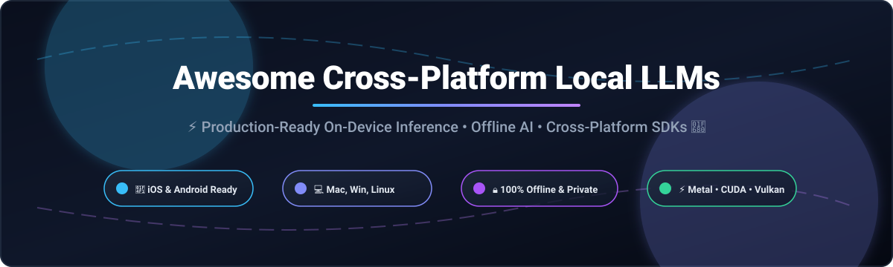

# Awesome Cross-Platform Local LLMs 🚀

  
  
  
  
  
  

**A curated index of top SaaS products and open-source GitHub projects for cross-platform local LLMs, on-device AI inference, offline intelligence, and multi-language SDKs.**

*Focusing on zero-latency, private, air-gapped on-device inference for iOS, Android, macOS, Windows, Linux, Web, and Edge IoT devices.*

---

## 📑 Table of Contents
- [✨ Overview](#-overview)
- [📊 Sector Overview & Market Dynamics](#-sector-overview--market-dynamics)
- [☁️ SaaS & Hosted Platforms](#️-saas--hosted-platforms)
- [💻 Open-Source GitHub Projects](#-open-source-github-projects)
  - [🏆 Top Category Leaders & Core Runtimes](#-top-category-leaders--core-runtimes)
  - [📱 Mobile, Flutter & Edge Embedded SDKs](#-mobile-flutter--edge-embedded-sdks)
  - [🖥️ Application & Orchestration Layer](#️-application--orchestration-layer)
- [💡 Hardware Constraints & Architecture Guide](#-hardware-constraints--architecture-guide)
- [🤝 How to Contribute](#-how-to-contribute)
- [☕ Support & Sponsorship](#-support--sponsorship)
- [📈 Star History](#-star-history)
- [⚖️ Disclaimer](#️-disclaimer)

---

## ✨ Overview

Running Large Language Models (LLMs) locally on-device represents the next frontier in artificial intelligence deployment. By running models directly on consumer smartphones, laptops, workstations, and edge appliances, developers eliminate costly cloud API bills, eradicate latency bottlenecks, and preserve strict user privacy with zero data leakage.

This directory tracks the most influential **SaaS platforms** and **open-source runtimes, SDKs, and applications** across the local AI ecosystem.

---

## 📊 Sector Overview & Market Dynamics

The **Edge AI and On-Device AI** market is projected to expand from approximately **$25–$30 billion in 2025–2026 to over $70–$90 billion by 2030–2033**, driven by an aggressive CAGR exceeding **20–28%** as NPU silicon permeates personal devices and enterprise hardware.

The sector exhibits a distinct structural duality: it is **highly concentrated at the semiconductor/silicon layer** (dominated by an oligopoly of Apple, Qualcomm, NVIDIA, AMD, and Intel), but remains **moderately to highly fragmented across the software toolchain and application layer**, where competing cross-platform runtimes (llama.cpp, ONNX, LiteRT, WebGPU) and specialized niche frameworks continuously vie for developer mindshare without a single winner-take-all monopoly.

---

## ☁️ SaaS & Hosted Platforms

The table below covers hosted and managed platforms that complement local and on-device LLM workflows, sorted descending by company scale (valuation / market capitalization):

| Product | Company | Company Scale (Valuation / Market Cap) | Pricing (Starting Tier) | Free Tier Limits / Free Trial | Key Capabilities & Best For |
| :--- | :--- | :--- | :--- | :--- | :--- |
| **[Google AI Edge Gallery](https://github.com/google-ai-edge/LiteRT-LM)** | Google (Alphabet Inc.) | **~$4.10T–$4.30T Market Cap** | **$0 / month** (100% Free & Open-Source) | **Unlimited free forever**; runs 100% locally on-device with zero cloud token charges | Mobile showcase app with Agent Skills, JavaScript modules, Thinking Mode reasoning visualization, prompt benchmarking, and MCP support on iOS & Android. |
| **[Ollama Cloud](https://ollama.com/)** | Ollama Inc. | **$88M Raised** (Series B funded, VC backed) | **$20 / month** (Pro Tier) | **Free tier forever**: 1 concurrent cloud model request with shared baseline usage capacity | Cloud-hosted open weights runner allowing seamless scaling from local CLI/daemon to cloud instances for 100B+ parameter models without code modifications. |
| **[LM Studio (Bionic)](https://lmstudio.ai/)** | Element Labs, Inc. | **Seed-funded private startup** | **$20 / month** (Bionic+ Tier) | **Free tier forever**: Core desktop app is 100% free for personal and commercial/workplace use; free cloud tier includes local runner & basic Bionic Agent features | Local model discovery desktop UI with Hugging Face integration, OpenAI-compatible local endpoints, and MLX Apple Silicon optimization. |

---

## 💻 Open-Source GitHub Projects

Curated open-source repositories powering the offline and on-device AI revolution, **sorted descending by GitHub star count**.

### 🏆 Top Category Leaders & Core Runtimes

* **[Ollama](https://github.com/ollama/ollama)**  🦙  
  **The de facto standard for running open LLMs locally** (MIT). One-command setup for macOS, Windows, and Linux. Ships local REST APIs with official Python/JavaScript SDKs and first-class MCP (Model Context Protocol) server support.

* **[Open WebUI](https://github.com/open-webui/open-webui)**  🌐  
  **Extensible, feature-packed self-hosted AI interface** (BSD-3-Clause). Connects effortlessly to Ollama, LocalAI, vLLM, or any OpenAI-compatible server. Adds multi-user RBAC, RAG document knowledge bases (13+ vector engines), web search browsing, and complete agent execution.

* **[llama.cpp](https://github.com/ggerganov/llama.cpp)**  ⚡  
  **The foundational C/C++ engine behind modern local inference** (MIT). Pioneered the GGUF model format and integer quantization (2-bit to 8-bit). Delivers blistering bare-metal CPU, Metal, CUDA, and Vulkan performance across Apple Silicon, PCs, and edge appliances.

* **[vLLM](https://github.com/vllm-project/vllm)**  🚀  
  **High-throughput and memory-efficient LLM serving engine** (Apache-2.0). Utilizes PagedAttention to minimize memory fragmentation, serving local LLMs at enterprise scale with distributed multi-GPU routing and OpenAI-compatible endpoints.

* **[GPT4All](https://github.com/nomic-ai/gpt4all)**  📚  
  **Local LLM platform with privacy-first document RAG and GPU acceleration** (MIT). Features *LocalDocs* for querying sensitive PDF/code repositories entirely offline. Supports Vulkan across AMD/Intel GPUs, Python SDK, and enterprise air-gapped sandboxes.

* **[AnythingLLM](https://github.com/Mintplex-Labs/anything-llm)**  📦  
  **All-in-one desktop and enterprise workspace AI application** (MIT). Zero-setup RAG, custom agentic workflows, multi-modal ingestion, and complete multi-tenant user permissions designed for local and self-hosted environments.

* **[LocalAI](https://github.com/mudler/LocalAI)**  🔌  
  **Drop-in self-hosted OpenAI, Anthropic, and ElevenLabs replacement** (MIT). Runs LLMs, audio transcription, image generation, and embeddings on commodity hardware. Features distributed cluster clustering with VRAM-aware load balancing and native MCP client tool calling.

* **[Text Generation WebUI](https://github.com/oobabooga/text-generation-webui)**  🎛️  
  **The swiss-army knife Gradio interface for local text generation** (AGPL-3.0). Supports multiple loaders (Transformers, llama.cpp, ExLlamaV2, AutoGPTQ), LoRA fine-tuning injection, prompt presets, and extensions.

* **[Jan](https://github.com/janhq/jan)**  🤖  
  **Open-source ChatGPT alternative that runs 100% offline** (AGPL-3.0). Elegant desktop client with OpenAI-compatible local server, modular extension marketplace, MCP client integration, and multi-engine backend.

* **[MLC-LLM](https://github.com/mlc-ai/mlc-llm)**  🧬  
  **Universal compiler-based deployment engine for on-device LLMs** (Apache-2.0). Compiles models natively to Vulkan, Metal, CUDA, ROCm, WebGPU, and iOS/Android runtimes for native hardware acceleration.

* **[WebLLM](https://github.com/mlc-ai/web-llm)**  🌍  
  **High-performance in-browser LLM inference engine** (Apache-2.0). Brings hardware-accelerated LLMs directly into web browsers via WebGPU without server-side compute.

* **[Transformers.js](https://github.com/huggingface/transformers.js)**  🤗  
  **State-of-the-art machine learning in the browser & Node.js** (Apache-2.0). Hugging Face's official JavaScript runtime for running text, vision, and speech models client-side with ONNX Runtime and WebGPU acceleration.

* **[LiteRT-LM (Google AI Edge)](https://github.com/google-ai-edge/LiteRT-LM)**  📱  
  **Google's production on-device LLM orchestration framework** (Apache-2.0). High-performance inference engine for Android, iOS, Web, Desktop, and Raspberry Pi with dedicated NPU/GPU acceleration, tool calling, and multimodal support for Gemma, Llama, and Qwen.

* **[Off Grid AI (OGAM)](https://github.com/off-grid-ai/OGAM)**  🛡️  
  **All-in-one offline AI application for iOS and Android** (MIT). Combines local LLM chat, on-device Whisper speech-to-text, vision analysis, and local tool execution with zero internet connectivity and zero telemetry.

* **[NobodyWho](https://github.com/nobodywho-ooo/nobodywho)**  🧩  
  **Universal cross-platform SDK for Flutter, React Native, Swift, Kotlin, and Godot** (EUPL-1.2). llama.cpp-backed engine with type-safe automatic grammar generation, tool calling, STT/TTS audio pipelines, and Metal/Vulkan GPU acceleration across 6 platforms.

---

### 📱 Mobile, Flutter & Edge Embedded SDKs

* **[Quaynor](https://pub.dev/packages/quaynor)** 🎯  
  **Flutter package for local offline inference** (MIT). Directly downloads GGUF models from Hugging Face (`huggingface:repo/model.gguf`) with Metal/Vulkan acceleration, RAG, and on-device tool calling.

* **[llamadart](https://pub.dev/packages/llamadart)** 🪶  
  **Zero-configuration Dart/Flutter plugin for llama.cpp** (MIT). Uses Dart Native Assets build hooks to bundle pre-compiled binaries automatically for Android, iOS, macOS, Windows, Linux, and Web (WASM). Supports runtime LoRA adapters and decoupled engine backends.

---

### 🖥️ Application & Orchestration Layer

* **[LM Studio](https://lmstudio.ai/)** 🎨  
  **Premier desktop GUI for running local models** (Proprietary, free for personal and workplace use). Clean model catalog with Hugging Face integration, quantization previews, Apple Silicon MLX acceleration, and OpenAI/Anthropic API emulation.

* **Community Workflow Automations (n8n & Flowise)** 🔄  
  Integration templates connecting local Ollama, LocalAI, or llama-cpp endpoints into multi-step agent pipelines, scheduled ETL scripts, and autonomous workflows without third-party cloud API costs.

---

## 💡 Hardware Constraints & Architecture Guide

Deploying local LLMs successfully requires matching model size and quantization to target hardware:

1. **RAM Headroom Rule**: As a rule of thumb, ensure total available system RAM/VRAM is at least **1.5× to 2× the GGUF model file size** to allocate KV cache, system processes, and context windows.
2. **Mobile Operating Limits**: iOS restricts single-app memory usage (1–2 GB system overhead); Android memory caps vary across manufacturers (2–4 GB headroom recommended). Models under **2 GB (e.g., 1B–2B parameter models at Q4_K_M)** run smoothly on modern flagship smartphones.
3. **Hybrid Architecture Pattern**: The dominant modern pattern pairs a local on-device model for high-frequency low-latency prompts (summarization, autocomplete, data extraction) with an on-demand cloud model (via Ollama Cloud or OpenAI APIs) reserved solely for complex reasoning tasks.

---

## 🤝 How to Contribute

Contributions are warmly welcome! Help make this ecosystem resource even better:

1. 🍴 Fork the repository.
2. 🌿 Create a descriptive branch: `git checkout -b feature/add-new-runtime`.
3. 📝 Add your entry with factual, concise details, official links, and GitHub star counts.
4. 📬 Submit a Pull Request with a clear explanation of why the tool benefits cross-platform local AI developers.

---

## ☕ Support & Sponsorship

If you find this curated ecosystem list helpful for your research, projects, or applications:

- ⭐ **Star this repository** to show support and boost visibility for the local AI community!
- 🍴 **Fork and share** with colleagues and developers building on-device AI.
- 💖 **Sponsor the project**: Consider buying a coffee or providing financial sponsorship via the [GitHub Sponsors Dashboard](https://github.com/sponsors/ishandutta2007). Your support fuels ongoing maintenance, benchmarking, and updates!

---

## 📈 Star History

---

## ⚖️ Disclaimer

- This is a community-curated directory intended for research and educational purposes.
- Users and developers must verify and adhere to respective model weight licenses (e.g., Llama Community License, Gemma Terms of Use) and data privacy regulations.
- All trademarks and brand names belong to their respective owners.
